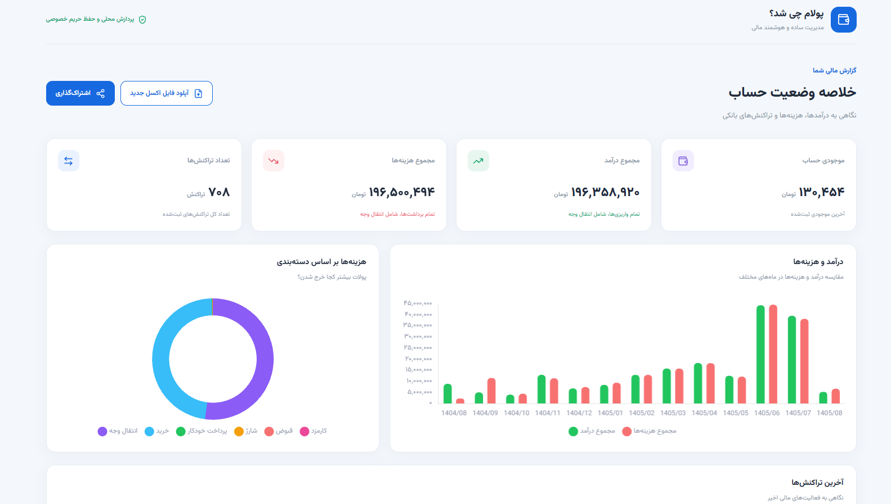
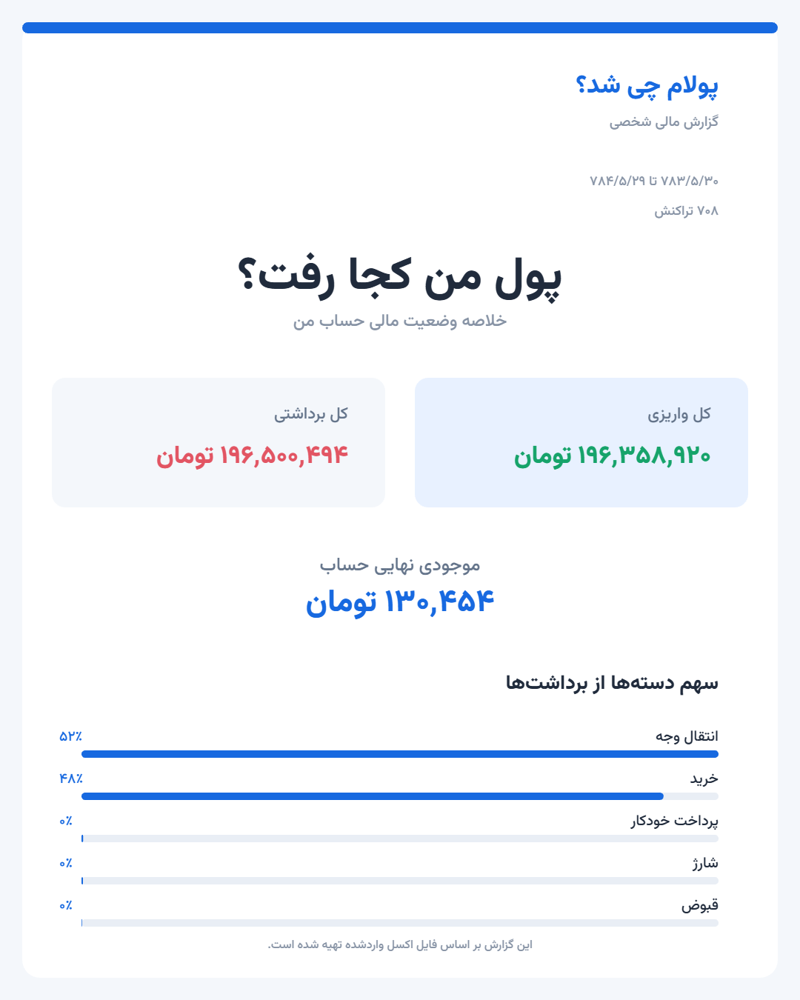

 

# 💸 پولام چی شد؟
### Where Did My Money Go?

**داشبورد متن‌باز مدیریت و تحلیل تراکنش‌های بانکی**

*A simple, open-source personal finance dashboard.*

---

## 📸 پیش‌نمایش پروژه | Preview

### داشبورد مالی | Financial Dashboard

### گزارش مالی قابل اشتراک‌گذاری | Shareable Financial Report

---

# 🇮🇷 فارسی

## درباره پروژه

«پولام چی شد؟» یک داشبورد مالی شخصی است که فایل اکسل تراکنش‌های بانکی را مستقیماً در مرورگر پردازش می‌کند و اطلاعاتی مثل موجودی حساب، درآمد، هزینه‌ها و جزئیات تراکنش‌ها را به شکل نمودار و گزارش نمایش می‌دهد.

هدف پروژه اینه که بدون نیاز به نرم‌افزارهای پیچیده، راحت‌تر متوجه بشیم پولمون کجا خرج شده و وضعیت مالی حسابمون چطوره.

## ✨ امکانات

- نمایش موجودی حساب، مجموع درآمد، مجموع هزینه‌ها و تعداد تراکنش‌ها
- نمودار مقایسه درآمد و هزینه‌های ماهانه
- دسته‌بندی و تحلیل هزینه‌ها
- مشاهده جزئیات تراکنش‌های بانکی
- صفحه‌بندی تراکنش‌ها برای نمایش بهتر اطلاعات
- بارگذاری و پردازش فایل Excel
- امکان بارگذاری فایل اکسل جدید و جایگزینی اطلاعات قبلی
- حفظ اطلاعات قبلی در صورت ناموفق بودن پردازش فایل جدید
- ساخت تصویر گزارش مالی شامل خلاصه وضعیت حساب و دسته‌بندی هزینه‌ها
- دانلود تصویر گزارش مالی با فرمت PNG
- رابط کاربری فارسی، راست‌چین و واکنش‌گرا

## 🔐 حریم خصوصی

این پروژه در حال حاضر کاملاً **Frontend-only** است و بک‌اند ندارد.

فایل اکسل مستقیماً در مرورگر کاربر پردازش می‌شود و اطلاعات مالی به سرور پروژه ارسال یا در آن ذخیره نمی‌شود.

*پردازش محلی به حفظ حریم خصوصی کمک می‌کند، اما امنیت صددرصدی قابل تضمین نیست.*

## 🚀 نحوه استفاده

1. پروژه را Clone یا دانلود کنید.
2. فایل `index.html` را در مرورگر باز کنید.
3. فایل Excel گردش حساب خود را بارگذاری کنید.
4. منتظر بمانید تا اطلاعات پردازش شوند.
5. آمار، نمودارها و جزئیات تراکنش‌ها را مشاهده کنید.
6. در صورت نیاز، فایل اکسل جدیدی بارگذاری کنید.
7. با استفاده از دکمه اشتراک‌گذاری، تصویر گزارش مالی خود را دریافت کنید.

*در حال حاضر فایل Excel باید با ساختار مورد انتظار پردازشگر پروژه و فرمت پشتیبانی‌شده بلو بانک سازگار باشد.*

## 🛠 تکنولوژی‌ها

- HTML5
- CSS3
- JavaScript (ES Modules)
- Chart.js
- SheetJS (xlsx)
- Lucide Icons

## 🤖 توسعه با کمک OpenAI

این پروژه با کمک ابزارهای هوش مصنوعی OpenAI، از جمله ChatGPT، توسعه داده می‌شود.

از هوش مصنوعی برای ایده‌پردازی، پیاده‌سازی قابلیت‌ها، حل مشکلات، دیباگ و بهبود ساختار کد استفاده می‌کنیم.

## 🌱 مشارکت

این پروژه متن‌باز است و از مشارکت دیگران استقبال می‌کنم.

اگر ایده‌ای دارید، باگی پیدا کردید یا دوست دارید در توسعه پروژه مشارکت کنید، خوشحال می‌شوم در کنار هم آن را بهتر کنیم.

می‌توانید پروژه را Fork کنید و تغییرات خود را با Pull Request به اشتراک بگذارید.

**خوشحال می‌شوم در توسعه این پروژه همراه شوید! ❤️**

---

# 🇬🇧 English

## About

**Where Did My Money Go?** is an open-source personal finance dashboard that processes bank statement Excel files directly in the browser and visualizes account balance, income, expenses, and transaction details.

The goal is to make personal financial tracking simpler and help users understand where their money goes.

## ✨ Features

- Account balance, total income, total expenses, and transaction count
- Monthly income and expense comparison charts
- Expense categorization and analysis
- Detailed transaction list
- Transaction pagination
- Excel file import and processing
- Upload and replace existing Excel data
- Preserve previous dashboard data if a new file fails to process
- Generate shareable financial report images
- Download financial reports as PNG files
- Persian RTL and responsive user interface

## 🔐 Privacy

This project is currently **frontend-only** and does not have a backend.

Excel files are processed directly in the user's browser. Financial data is not sent to or stored on this project's servers.

*Local processing helps protect privacy, but absolute security cannot be guaranteed.*

## 🚀 How to Use

1. Clone or download this repository.
2. Open `index.html` in your browser.
3. Upload your bank statement Excel file.
4. Wait for the data to be processed.
5. Explore your financial overview, charts, and transactions.
6. Upload another Excel file whenever you want to replace the current data.
7. Use the Share button to generate and download a PNG financial report.

*The Excel file must match the format expected by the parser. Currently, the project supports the Blue Bank Excel statement format.*

## 🛠 Built With

- HTML5
- CSS3
- JavaScript (ES Modules)
- Chart.js
- SheetJS (xlsx)
- Lucide Icons

## 🤖 Developed with OpenAI

This project is developed with the assistance of OpenAI technologies, including ChatGPT.

AI helps with brainstorming, feature implementation, problem-solving, debugging, and code improvements.

## 🌱 Contributions

This project is open source, and contributions are welcome!

If you have an idea, find a bug, or want to help improve the project, I'd be happy to have you involved.

Feel free to fork the repository and submit a Pull Request.

**I'd be happy to build this together with you! ❤️**

---

Made with ❤️, JavaScript, and the help of OpenAI.

